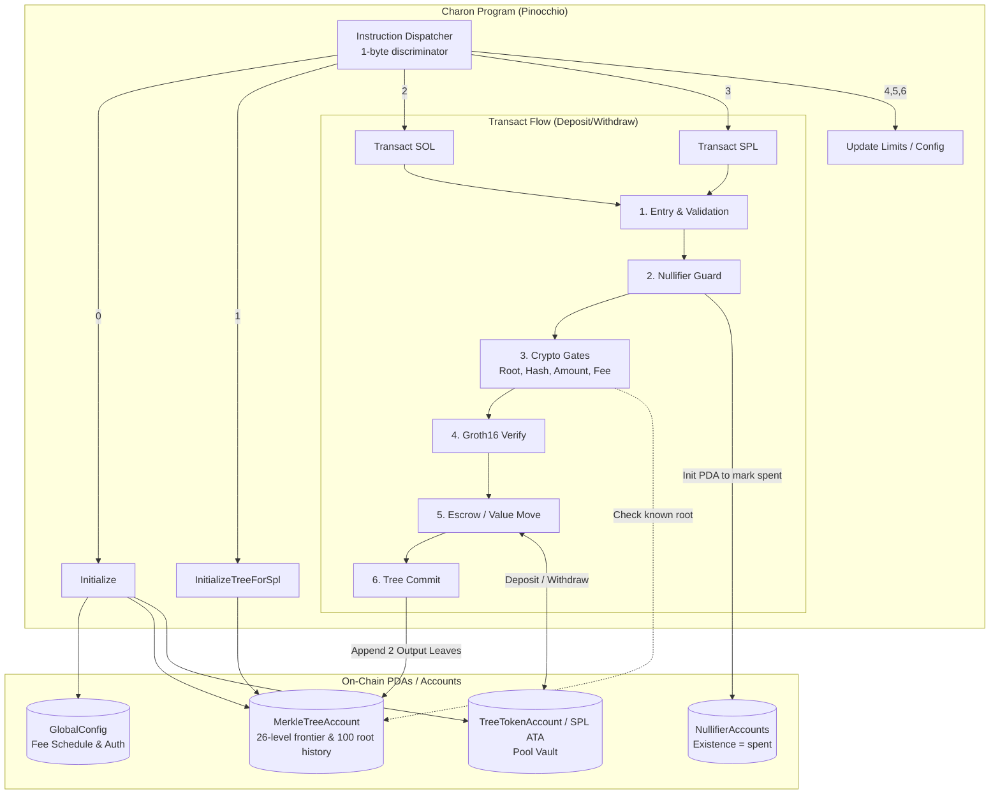

# Charon: On-Chain Architecture

This document outlines the architecture and execution flow of the Charon on-chain program, which is built using Pinocchio.

## Overview

The on-chain program provides a zero-knowledge privacy pool on Solana, supporting both native SOL and SPL tokens. It utilizes a Poseidon Merkle tree for commitments, a Groth16 verifier over the BN254 curve, and a nullifier set to prevent double spending.

## Architecture Diagram

## The Five Gates of Transact

Before any value moves, the `Transact` instruction passes through five critical gates:
1. **Root in History**: The proof's root must match one of the last 100 roots in the `MerkleTreeAccount`.
2. **Ext-Data Hash**: Recomputes the SHA-256 hash of public signals (recipient, amount, fee, mint) and compares it to the proof.
3. **Public Amount**: Recomputes public amount from external amount and fee.
4. **Fee Bounds**: Checks that the fee respects the configured global schedule.
5. **Groth16 Verify**: Evaluates the pairing check over the 7 public inputs on the BN254 curve.

The **Nullifier Guard** creates new PDAs for the input nullifiers *before* these checks or any token transfers happen, rendering the contract structurally reentrancy-proof. It also applies a cross-tree guard (swapped-prefix derivation) to ensure nullifiers cannot be reused across different trees.

## The Transact Primitive (ext_amount)

The single `Transact` instruction supports three behaviors depending entirely on the sign of the `ext_amount`:
- `ext_amount > 0`: **Deposit**. The signer pays the pool. Two new output commitments are appended.
- `ext_amount < 0`: **Withdraw**. The vault pays the recipient and a fee. Two input nullifiers are spent.
- `ext_amount == 0`: **Transfer**. Fully private internal transfer. No public value moves (except an optional fee).

## SPL Support
For SPL tokens (`TransactSpl`), each mint receives its own independent Merkle tree (`["merkle_tree", mint, bump]`). Value transfers occur through a dedicated pool ATA `tree_ata`, which is owned by the singleton `global_config` PDA. Outbound SPL transfers are signed programmatically via CPI using the `global_config` seeds.
