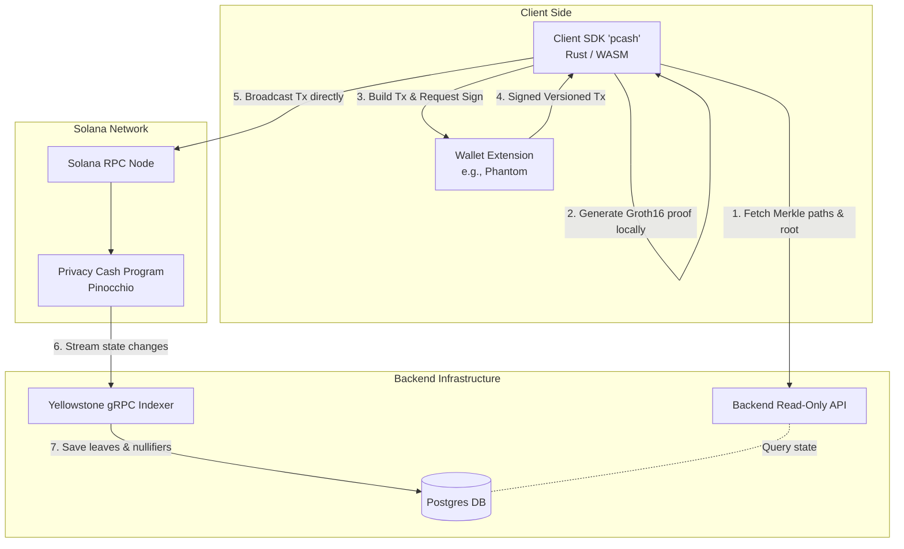

# Privacy Cash: System Architecture

This document illustrates the end-to-end system architecture of the Privacy Cash protocol. 

## Overview

Privacy Cash consists of an off-chain Client SDK, the Solana Program, and a read-only Backend Indexer. There is no relayer involved in submitting transactions; the client SDK interacts directly with the Solana RPC.

## Architecture Diagram

## System Flow

1. **Scan and Sync**: The client SDK pages through encrypted output leaves via the Backend's read-only API (`/api/utxos/range`). It decrypts these locally using the user's spending key to identify owned notes without revealing ownership to the backend.
2. **Local Proof Generation**: The client SDK constructs a Groth16 zero-knowledge proof locally on the user's machine. To withdraw, the SDK fetches the current Merkle path for the owned note from the Backend API.
3. **Direct Submission**: The client SDK formats a `Transact` or `TransactSpl` instruction, requests a signature from the user's wallet, and submits the raw transaction directly to the Solana RPC. There is no relayer involved in this path.
4. **Program Verification**: The Solana program verifies the proof and processes the transaction, appending new commitment leaves and initializing nullifier PDAs.
5. **Indexing**: The Backend Indexer listens to confirmed program transactions via a Yellowstone gRPC stream. It decodes the events and stores newly appended leaves and nullifiers in a Postgres database.
6. **Operator Admin**: For program configuration (e.g. updating deposit caps, fee rates), operators use specialized POST endpoints (`/api/relayer/*`) on the backend, which constructs and signs the transaction as the operator to interact with the program.
