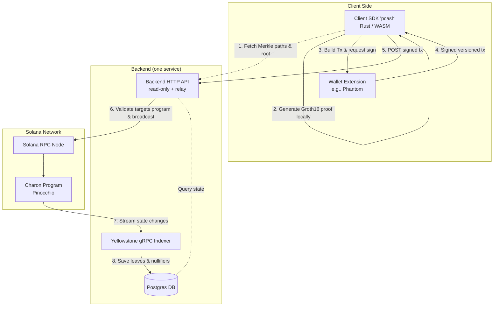

# Charon: System Architecture

This document illustrates the end-to-end system architecture of the Charon protocol. 

## Overview

Charon consists of an off-chain Client SDK, the Solana Program, and a Backend. The Backend plays three roles: a Yellowstone gRPC indexer that mirrors the chain into Postgres, a read-only HTTP API that serves Merkle proofs / roots / nullifier status / fees, and a broadcast relay.

The wallet signs every user transaction client-side. The SDK then POSTs the signed transaction to the Backend's `POST /api/relayer/submit` endpoint; the Backend validates that the transaction targets the charon program (`assert_targets_program`) and broadcasts it to the Solana RPC. The Backend holds no user signing key and cannot redirect a withdrawal — the recipient is baked into the proof the wallet signs — so the frontend needs no public RPC endpoint of its own.

## Architecture Diagram

## System Flow

1. **Scan and Sync**: The client SDK pages through encrypted output leaves via the Backend's read-only API (`/api/utxos/range`). It decrypts these locally using the user's spending key to identify owned notes without revealing ownership to the backend. Decrypted notes live only in page memory for the unlocked session (never written to the browser); the sole durable copy is an AES-256-GCM ciphertext blob the SDK pushes to the backend (`encrypted_notes` table), keyed by wallet and unreadable by the server. If that blob is ever lost, this scan rebuilds the note set, so no funds are locked out.
2. **Local Proof Generation**: The client SDK constructs a Groth16 zero-knowledge proof locally on the user's machine. To withdraw, the SDK fetches the current Merkle path for the owned note from the Backend API.
3. **Relayed Submission**: The client SDK formats a `Transact` or `TransactSpl` instruction and requests a signature from the user's wallet. It then POSTs the signed transaction to the Backend's `POST /api/relayer/submit` endpoint. The Backend verifies the transaction targets the charon program (`assert_targets_program`) and broadcasts it to the Solana RPC. The Backend never holds a user signing key and cannot alter the signed payload, so the frontend requires no public RPC endpoint.
4. **Program Verification**: The Solana program verifies the proof and processes the transaction, appending new commitment leaves and initializing nullifier PDAs.
5. **Indexing**: The Backend Indexer listens to confirmed program transactions via a Yellowstone gRPC stream. It decodes the events and stores newly appended leaves and nullifiers in a Postgres database.
6. **Operator Admin**: For program configuration (e.g. updating deposit caps, fee rates), operators use specialized POST endpoints (`/api/relayer/*`) on the backend, which constructs and signs the transaction as the operator to interact with the program.
